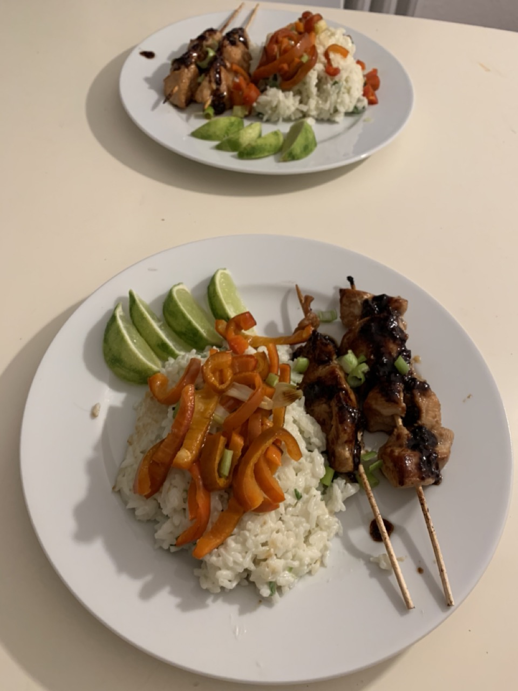

# Asian Chicken Skewers with Coconut-Lime Rice
Fresh and authentic Asian taste

**Provided by:** Karl

## Stats
- Cooking Time: 30 min
- Servings: 4 

## Ingredients

**For the skewers and marinade**
- 4 chicken breast fillets (approx. 600 g)
- 1 piece of ginger 
- 2 garlic cloves
- 4 tbsp soy sauce
- 2 tbsp honey
- 2 tbsp vegetable oil
- 8 wooden skewers

**For the coconut-lime rice**
- 300 g jasmine rice
- 300 ml coconut milk (1 can)
- 300 ml water
- 1 lime
- 1 tsp salt

**For the vegetables**
- 2 red pointed peppers
- 4 spring onions
- 2 tbsp vegetable oil

## Instructions
- Step 1
- Step 2