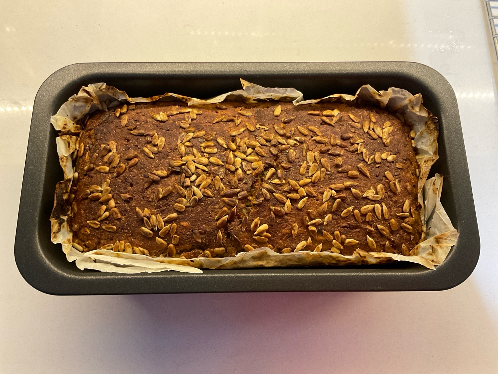

# Rugbrød

Rugbrød is a traditional Danish rye bread made with whole grains and seeds. It is special to me because I spent a lot of time experimenting to perfect my recipe.

**Provided by:** Berkay

## Stats
- Cooking Time: ...
- Servings: ...

## Ingredients
- 1 kg Butter 
- 10 g Salt

## Instructions
- Step 1
- Step 2