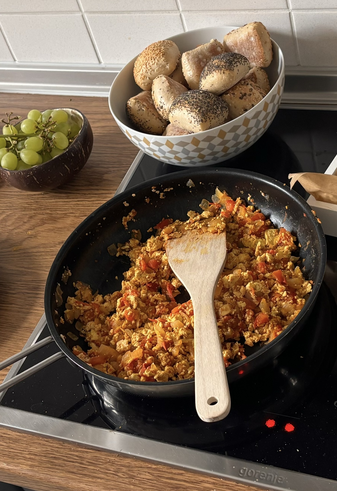

# Vegan Scrambled Eggs
This is a recipe for vegan scrambled eggs. It's made of tofu and for this delicious meal no animals are harmed or exploited. 

**Provided by:** Your Name (or pseudonym)

## Stats
- Cooking Time: ...
- Servings: ...

## Ingredients
- 1 kg Butter 
- 10 g Salt

## Instructions
- Step 1
- Step 2